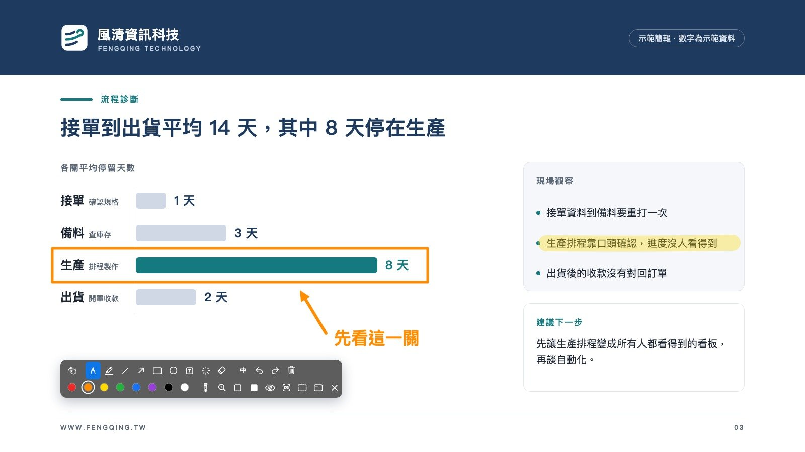
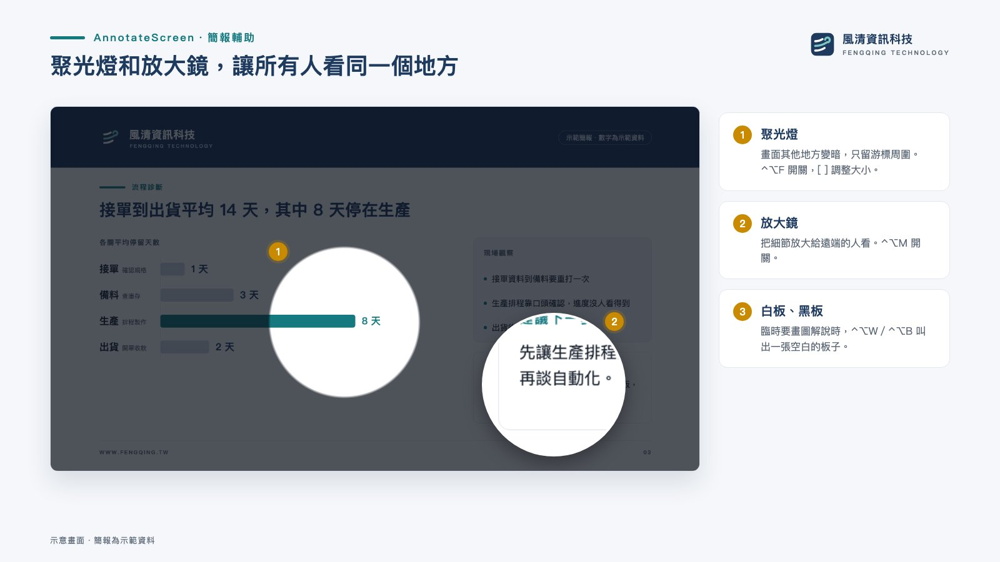
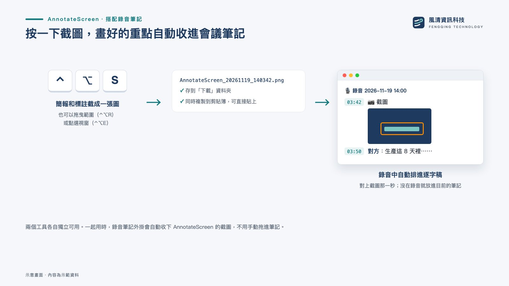
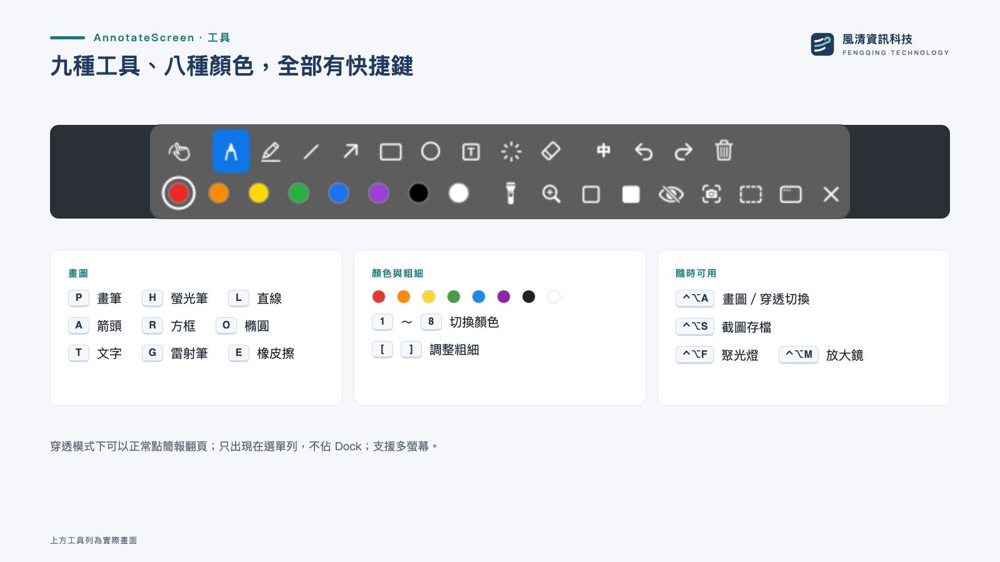

# AnnotateScreen

A lightweight macOS screen annotation tool for presenters: draw on top of anything while sharing your screen, then save "slides + annotations" as one image with a hotkey.
Native Swift/AppKit, builds with Command Line Tools only (no Xcode needed). Docs are in Traditional Chinese.
Free and open source. If it saves you time, you can support its maintenance on [Ko-fi](https://ko-fi.com/fengqingtech).



macOS 螢幕標註工具：在 Teams 這類會議軟體分享螢幕時，直接在畫面上畫重點，一個快捷鍵把「簡報＋標註」截圖存檔。免費、開放原始碼。

**先確認這兩件事，再決定要不要用：**

- 只能在 **Apple Silicon 的 Mac** 上用。
- **沒有提供編譯好的 App**，要在終端機自己建置。建置本身約 1 分鐘，不含安裝 Command Line Tools；不需要安裝 Xcode。

## 它幫你做什麼

- **講到哪裡畫到哪裡。** 九種工具：畫筆、螢光筆、直線、箭頭、方框、橢圓、文字、雷射筆、橡皮擦；八種顏色
- **帶大家看同一個地方。** 聚光燈、放大鏡、白板、黑板
- **畫完留得下來。** 三種截圖：整個螢幕、拖曳範圍、點選視窗；存到「下載」並複製到剪貼簿
- **不打擾平常的操作。** 支援多螢幕；只出現在選單列，不佔 Dock
- **不連網路。**

## 使用情境

以下畫面都是示意，簡報與內容為示範資料。

### 線上簡報：邊講邊畫

在 Teams 分享整個螢幕時，按 ⌃⌥A 進入畫圖模式，直接在簡報上圈重點、畫箭頭。要翻頁時再按一次，切回穿透模式就能正常操作簡報。

### 帶大家看同一個地方

講到細節時打開聚光燈（⌃⌥F），畫面其他地方變暗；數字太小就用放大鏡（⌃⌥M）。遠端的人不用再問「你說的是哪裡」。



### 會後留存：一鍵截圖

按 ⌃⌥S，簡報和標註一起存成一張圖，放在「下載」並複製到剪貼簿，可以直接貼上。搭配 [錄音筆記](https://github.com/FengQing-TW/obsidian-meeting-recorder) 時，截圖會自動收進會議筆記，錄音中還會排到截圖那一秒。



## 安裝

### 1. 準備環境

- Apple Silicon 的 Mac。最低需求設為 macOS 14；開發與實際使用都在 macOS 27，其他版本沒有實測
- Command Line Tools（在終端機執行 `xcode-select --install`），不需要 Xcode

### 2. 建置並啟動

```bash
git clone https://github.com/FengQing-TW/annotate-screen.git
cd annotate-screen
./tools/setup_signing.sh   # 只要第一次：建立本機簽章憑證
./build.sh    # 建置並安裝到 /Applications/AnnotateScreen.app（執行中會先結束、裝好再重新啟動）
./test.sh     # 單元測試（可以不跑）
```

- `setup_signing.sh` 會在這台 Mac 的「登入」鑰匙圈建立一張自簽憑證「AnnotateScreen Local Signing」，只給這台 Mac 用。這樣重新建置後，螢幕錄製權限不必重開。要移除時，到「鑰匙圈存取」的「登入」刪掉它。
- `build.sh` 和 `test.sh` 跑完都會刪掉 `.build` 編譯暫存，所以每次都是完整重新編譯（release 約 1 分鐘）。
- 啟動：⌘Space 輸入 `Annotate`，或從「應用程式」開啟；啟動後只出現在選單列（筆尖圖示）。
- 想開機自動啟動，加入「系統設定 → 一般 → 登入項目」。
- `INSTALL_DIR=<目錄> ./build.sh` 可改安裝位置（測試用）。

## 使用前要知道

**AnnotateScreen 開著時，其他程式的 ⌘4 會失效。** ⌘4 被用來切換畫筆和滑鼠；切回滑鼠時會清掉標註，可以用 ⌃⌥Z 還原。

在 Teams 分享時：

1. **分享「螢幕」，不要只分享「視窗」**——只分享 PowerPoint 視窗時，對方看不到標註。
2. 用 PowerPoint Live（在 Teams 裡上傳簡報）時也看不到標註。

權限：第一次截圖或開放大鏡時，系統會要求「螢幕與系統錄音」權限；打開後重開 AnnotateScreen。已用固定的本機憑證簽章，重新建置後不必再開（新電腦要先跑一次 `tools/setup_signing.sh`）。

## 快捷鍵



| 全域 | 功能 |
| :-- | :-- |
| ⌃⌥A | 切換畫圖／穿透（穿透時可正常點簡報翻頁） |
| ⌃⌥S | 截圖（存到「下載」資料夾 ~/Downloads，檔名 AnnotateScreen_日期_時間.png，並複製到剪貼簿） |
| ⌃⌥R | 範圍截圖（拖曳選一塊矩形，只截那一塊；存檔與剪貼簿同 ⌃⌥S；Esc 或右鍵取消） |
| ⌃⌥E | 視窗截圖（游標移到視窗上會高亮，點一下截那個視窗在螢幕上的範圍，標註一起入鏡；存檔與剪貼簿同 ⌃⌥S；Esc 或右鍵取消） |
| ⌘4 | 畫筆／滑鼠來回切換：畫圖中按＝清除所有螢幕的標註並回到滑鼠控制（清掉的可用 ⌃⌥Z 一次還原）；再按一次＝回到畫筆。**AnnotateScreen 開著時，其他程式的 ⌘4 會失效** |
| ⌃⌥X | 清除游標所在螢幕的標註（工具列、選單的「清除」是清除所有螢幕） |
| ⌃⌥Z | 復原 |
| ⌃⌥F／⌃⌥M | 聚光燈／放大鏡（開啟時 `[` `]` 調整大小） |
| ⌃⌥W／⌃⌥B | 白板／黑板 |
| ⌃⌥H | 隱藏／顯示標註 |
| ⌃⌥T | 顯示／隱藏工具列 |

| 畫圖模式內 | 功能 |
| :-- | :-- |
| P H L A R O T G E | 畫筆、螢光筆、直線、箭頭、方框、橢圓、文字、雷射筆、橡皮擦 |
| 1～8 | 顏色：紅、橙、黃、綠、藍、紫、黑、白 |
| `[` `]` | 粗細 |
| ⌘Z／⇧⌘Z | 復原／重做 |
| ⌫ | 清除目前畫面（可復原） |
| Shift＋拖曳 | 直線鎖 45°、正方形、正圓 |
| Esc | 結束畫圖 |

## 權限

| 功能 | 需要的權限 |
| :-- | :-- |
| 畫圖、聚光燈、白板／黑板 | 不需要 |
| 截圖、放大鏡 | 螢幕與系統錄音 |
| 存檔 | 第一次會詢問能不能取用「下載」資料夾 |

## 搭配 Obsidian

截圖固定存到 `~/Downloads`，檔名 `AnnotateScreen_yyyyMMdd_HHmmss.png`。搭配的 Obsidian 錄音外掛靠這個位置和檔名把截圖收進筆記，所以這兩項不要改。

## 支援

這是自用工具，照現況提供，不保證回覆問題或修正。

免費、開放原始碼。覺得好用的話，歡迎在 [Ko-fi](https://ko-fi.com/fengqingtech) 請我們喝杯咖啡，支持後續維護。

## 授權

MIT，見 [LICENSE](LICENSE)。
